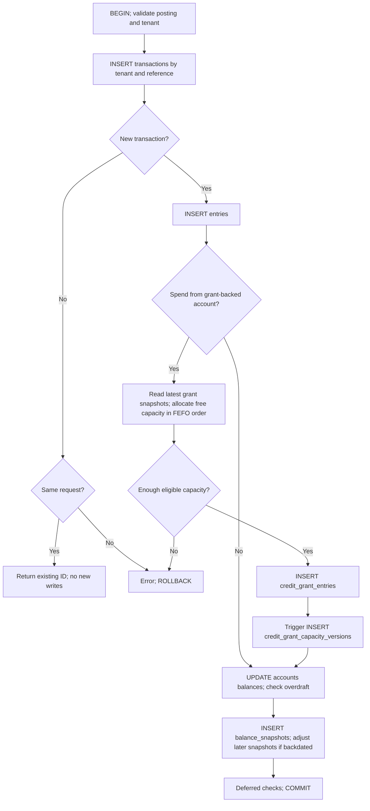

# Transaction write-path overview

A posting on ordinary accounts does not allocate grants or calculate grant remaining/reserved capacity. Grant-backed spending adds an optional attribution branch to the same posting workflow.

## Posting a spend

This diagram covers creating a posting, not issuing grants, committing a hold or reversing a transaction. All writes are inside one PostgreSQL transaction. Any error, including a deferred constraint failure, rolls back every write in the call.

Before inserting the transaction, touched grant-enabled accounts are locked in account-ID order. Within grant attribution, grants are locked in FEFO order (expiry, creation time, ID). The diagram omits these mechanics to emphasize writes and branches.

For each grant-backed account, latest `remaining_minor` and `reserved_minor` are read together once, not once per debit entry. The allocation loop distributes debit amounts across eligible grants using a local map of `remaining - reserved`. Each allocation reduces that local free amount. Insufficient capacity aborts the whole posting. Ordinary spending reduces snapshot remaining capacity but leaves reserved capacity unchanged.

`entries` are financial posting legs. `credit_grant_entries` explain which grants funded those legs; they are not a second financial posting. Neither a new grant nor a hold allocation is created by this spend.

## Other operation branches

| Operation | Records created | Existing records changed |
| --- | --- | --- |
| Reserve | `holds`, `hold_entries`, `credit_grant_hold_allocations`; triggers append `credit_grant_capacity_versions` | Account reservation totals; no posted-balance change |
| Partial/full hold commit | `transactions`, `entries`, `credit_grant_entries`, `credit_grant_capacity_versions`, `balance_snapshots` | Account balances and reservations; hold remaining amount and state |
| Void hold | `credit_grant_capacity_versions` releasing unconsumed allocations | Account reservations; hold becomes VOIDED; no financial posting |
| Reverse | Compensating `transactions`, `entries`, grant lineage/capacity versions where applicable, account snapshots | Account balances; original journal records remain unchanged |

Grant-specific records in this table apply only to grant-backed accounts. Partial commit spends only the committed portion and keeps the remainder reserved. Full commit leaves no remainder and makes the hold APPLIED. Void releases only the uncommitted remainder. A failed call rolls back its own changes, not earlier successful partial commits.

## Four grant-specific tables

| Table | Purpose |
| --- | --- |
| `credit_grants` | Grant identity, ownership and expiry |
| `credit_grant_entries` | Financial attribution: issuance, consumption and compensating events |
| `credit_grant_hold_allocations` | Immutable attribution of a reservation to grants |
| `credit_grant_capacity_versions` | Append-only remaining/reserved snapshots |

Account-level `balance_snapshots` do not replace grant-level snapshots: they do not identify which grant has free capacity.

Diagram source is editable Mermaid. Keep it synchronized with the [posting implementation](../../packages/postgres-adapter/src/repositories/transaction-repository.ts), [hold implementation](../../packages/postgres-adapter/src/repositories/hold-repository.ts) and [SQL guards](../../drizzle/0004_grant_hold_allocations.sql) when behavior changes.
